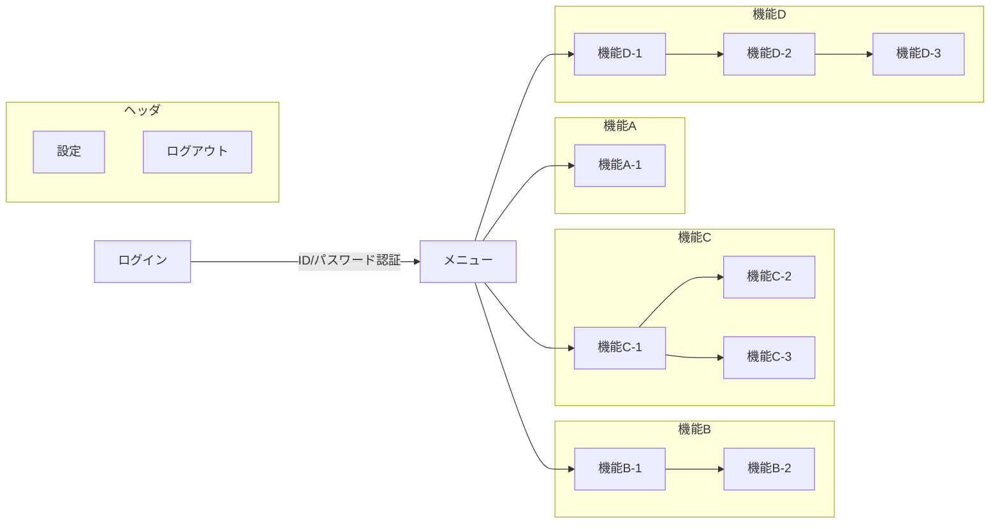

# 基本設計書作成スキル

このスキルは基本設計書を作成するためのスキルです。

## 前提条件

基本設計書を作成する前に以下のタスクが完了している必要があります。

- **要件定義書が完成している**
  基本設計書は要件定義で定義した内容をシステムがどのように実現するかを定義するものです。要件定義が完了していない場合は、先に要件定義書を作成してください。承認済みの要件定義書は、`docs/specs/requirements-definition.md` に保存されているはずです。

## 基本設計書の標準構成

以下の構成を基本とする。プロジェクトの特性上不要なセクションがある場合は、ユーザーに確認のうえ省略してよい。

1. アーキテクチャ設計
2. 画面設計
3. API設計
4. バッチ処理設計
5. 帳票・ファイル設計
6. ストレージ設計

## 基本設計書の詳細

### アーキテクチャ設計

システムの全体構成と実装方針を定義する。機能要件・非機能要件を踏まえ、アプリケーションで実装すべき処理と製品・ミドルウェアでカバーするコンポーネントを切り分ける。

少なくとも次の内容を書く。

- システム構成（どのコンポーネントが存在し、どのように連携するか）
- ソフトウェア構成（OS・ミドルウェアの選定と役割）
- ネットワーク構成（通信経路と境界）
- アプリケーション機能構成（開発するシステムの機能一覧）
- 技術スタック（言語・フレームワーク・主要ライブラリ・DB、および**テスト／自動化ツール**・Lint・CI）

技術スタックは**プロジェクト固有のツール選定の正本**として、独立した見出しを立てて記載する。テストツール（テストランナー・E2Eツール等）もここに含める。CLAUDE.md（プロジェクト大原則）には技術スタックを書かず、本基本設計書を参照させる方針とする。

システム構成図およびネットワーク構成図は mermaid 記法で作成し、基本設計書に埋め込む。ただし、mermaid で表現しきれない複雑な構成の場合は draw.io 等の外部ツールを使用してよい。

### 画面設計

ユーザーが操作する画面の全体像と個別仕様を定義する。

#### 画面一覧

作成する画面を洗い出し、ID・画面名・概要・遷移元・遷移先を一覧化する。

#### 画面遷移

画面間の遷移関係を整理する。画面遷移図は mermaid記法で作成し、基本設計書に埋め込む形で保存する。ただし、複雑すぎる場合は別ファイルに分けて保存してもよい。



#### 画面仕様

各画面について少なくとも次の内容を書く。

- 画面名
- 表示項目（ラベル・入力フォーム・ボタンなど）
- 処理内容（アクション定義とビジネスロジック）

### API設計

システムが提供または利用するAPIの仕様を定義する。API仕様は基本設計書本体とは別ファイルで管理する。

- `docs/specs/basic-design.md` にはAPI一覧（概要）と参照先を記載する
- 詳細仕様は OpenAPI 3.0 形式（YAML）で `docs/specs/api/openapi.yaml` に記述する

API一覧には少なくとも次の内容を含める。

- 各エンドポイントのパス・メソッド・概要
- 詳細は `docs/specs/api/openapi.yaml` を参照する旨の明記

### バッチ処理設計

定期または非同期で実行するバッチ処理の仕様を定義する。

少なくとも次の内容を書く。

- バッチ処理一覧（ID・バッチ名・実行タイミング・概要）
- 各バッチの詳細（処理内容・入出力・エラー時の挙動）

### 帳票・ファイル設計

システムで出力する帳票やファイルの仕様を定義する。

少なくとも次の内容を書く。

- 帳票・ファイル一覧（ID・名称・出力トリガー・フォーマット・概要）
- 各帳票・ファイルの詳細（レイアウト・出力項目・出力条件）

### ストレージ設計

システムで使用するデータベースやその他ストレージの設計を定義する。

少なくとも次の内容を書く。

- 使用するストレージの種類と選定理由
- データモデル（ER図）— mermaid の `erDiagram` 記法で作成し、基本設計書に埋め込む。mermaid で表現しきれない場合は draw.io 等を使用してよい
- 主要テーブル・コレクションのスキーマ定義（カラム名・型・制約・説明）

## 基本設計書作成プロセス

### 1. 技術スタックの確認

基本設計書の作成を始める前に、まずユーザーに現在想定している技術スタックを確認する。テンプレート化しすぎると案件ごとの差分を吸収しにくいため、**自由フォーマットで回答してもらう**。

ただし、回答しやすいように最低限の確認項目サンプルは提示する。例えば、次のような項目を案内する。

- 開発言語
- フロントエンド
- バックエンド
- データベース
- インフラ、実行環境
- 認証、認可
- 外部サービス、外部API
- 開発、運用ツール

ユーザーへの確認は、例えば次のように案内してよい。

```text
基本設計に入る前に、想定している技術スタックを自由形式で教えてください。

最低限、次の項目が分かると設計に反映しやすいです。
- 開発言語
- フロントエンド
- バックエンド
- データベース
- インフラ / 実行環境
- 認証 / 認可
- 外部サービス / 外部API
- 開発 / 運用ツール

箇条書きでも文章でも構いません。未定の項目があれば「未定」と書いてください。
```

### 2. requirements-definition.md の確認

まず、承認済みの要件定義書を確認する。機能要件・非機能要件・ターゲットユーザーを把握し、設計の方向性を定める。

```bash
Read('docs/specs/requirements-definition.md')
```

### 3. 基本設計書ドラフトの生成

要件定義書の内容をもとに、以下の2ファイルを生成する。

**基本設計書本体**: テンプレート（`./template.md`）に従って生成し、`docs/specs/basic-design.md` に保存する。

**OpenAPI仕様**: テンプレート（`./openapi-template.yaml`）に従って生成し、`docs/specs/api/openapi.yaml` に保存する。基本設計書本体の API設計セクションには概要一覧のみ記載し、詳細は `docs/specs/api/openapi.yaml` を参照する形にする。

手順1でヒアリングした技術スタックを、アーキテクチャ設計の「技術スタック」セクションに記載する（テスト／自動化ツールを含む）。この技術スタックがプロジェクト固有のツール選定の正本となる（CLAUDE.md には書かない）。記載した技術スタックを考慮し、ストレージ設計・アーキテクチャ設計の内容をプロジェクトに合わせて具体化すること。

### 4. 基本設計書のレビューと改善

生成された基本設計書を以下の観点でレビューする。

- 要件定義書の全機能要件がいずれかのセクション（画面・API・バッチ）でカバーされているか
- 非機能要件（性能・可用性・セキュリティ）がアーキテクチャやストレージ設計に反映されているか
- アーキテクチャ設計がシステム構成・ソフトウェア構成・ネットワーク構成・機能構成を網羅しているか
- 画面一覧と画面遷移が矛盾していないか
- API設計のリクエスト・レスポンス定義が機能要件を満たしているか
- ストレージ設計のスキーマが機能要件で必要なデータを保存できる構造になっているか
- プロジェクトで使用する技術スタックと設計の内容が整合しているか

レビューで不足や矛盾が見つかった場合は、以下の順で改善する。

1. 要件との矛盾を修正する
2. 抜けているセクションや項目を要件定義書から補完する
3. 技術スタックに合わない記述を修正する
4. 詳細設計・実装で判断できる程度に粒度を整える

特に、次のような記述はそのまま残さない。

- 要件定義書に記載された機能に対応するAPI・画面・バッチが存在しない状態
- テーブル定義の型や制約が空欄のままのスキーマ定義
- 「適切に設計する」「必要に応じて対応する」など判断基準が不明な記述

レビュー完了時には、少なくとも次の状態になっていること。

- 基本設計書だけを読んで、システムの全体構成・主要画面・APIの概要・データ構造を説明できる
- 後続の詳細設計でコンポーネントごとの実装仕様に入れる粒度で設計が整理されている
- 要件定義書で定義された機能要件がすべて基本設計書のいずれかのセクションに反映されている

### 5. ユーザー承認の取得

基本設計書が完了したら、次の工程に進む前に、必ず承認を得てください。

### 6. 基本設計書の保存

ユーザーの承認を得て完成となった基本設計書は、`docs/specs/basic-design.md` に保存してください。
