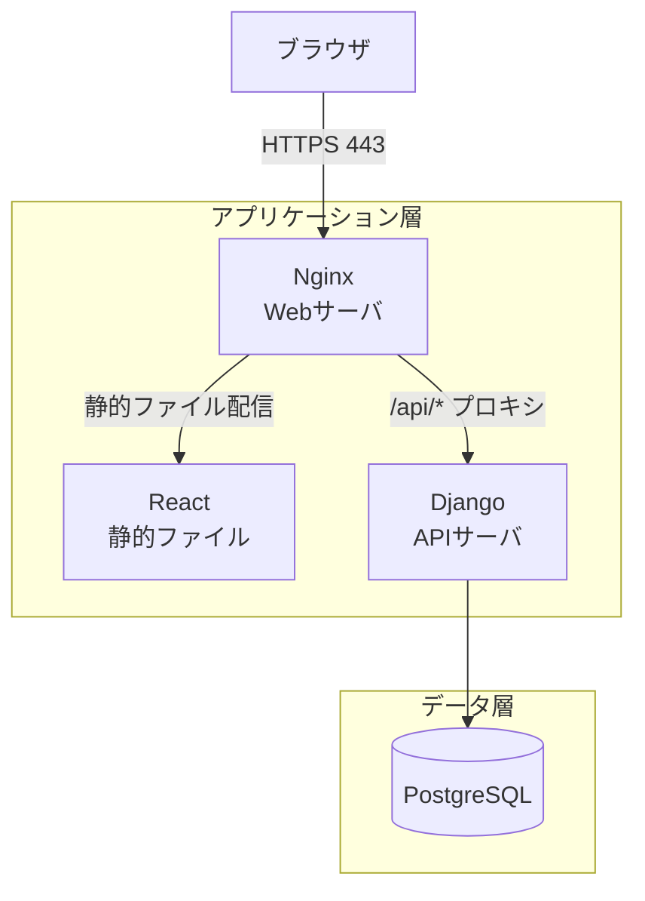
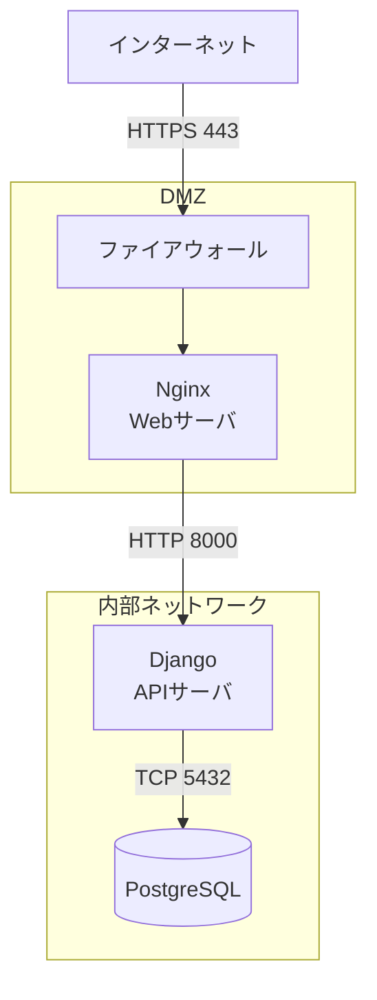
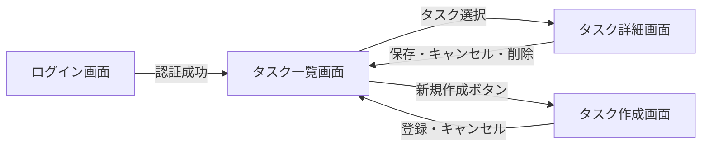
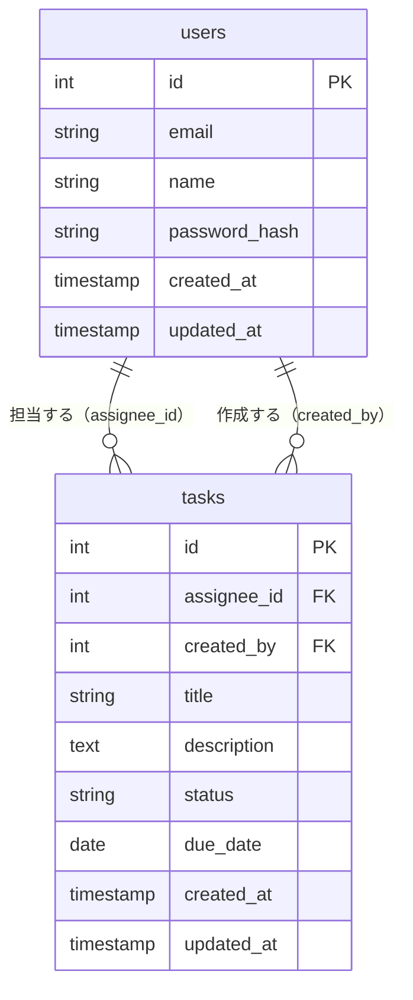

# 基本設計書テンプレート

## 1. アーキテクチャ設計

### 1-1. システム構成

ユーザーのブラウザから React フロントエンドを介して Django REST API にアクセスし、PostgreSQL にデータを永続化する3層構成。静的ファイルは Nginx が配信し、API リクエストのみ Django にプロキシする。

[mermaid で表現しきれない場合は draw.io 等で作成する。]

### 1-2. ソフトウェア構成

| コンポーネント | 製品・技術 | バージョン | 役割 |
| --- | --- | --- | --- |
| Webサーバ | Nginx | 1.24 | リクエストのプロキシ・静的ファイル配信 |
| フロントエンド | React | 18.x | UI レンダリング・ユーザー操作の処理 |
| バックエンド | Django / Django REST Framework | 4.x / 3.x | ビジネスロジック・API 提供 |
| データベース | PostgreSQL | 15.x | データの永続化 |
| コンテナ | Docker / Docker Compose | 24.x | 開発・本番環境の統一 |
| 言語（バックエンド） | Python | 3.11 | サーバサイド実装 |
| 言語（フロントエンド） | JavaScript (ES2022) | — | クライアントサイド実装 |

### 1-3. ネットワーク構成

外部からのアクセスはファイアウォールを経由し、DMZ 内の Nginx に到達する。アプリケーション・DB サーバは内部ネットワークに隔離し、直接外部からアクセスできない構成とする。

[mermaid で表現しきれない場合は draw.io 等で作成する。]

### 1-4. アプリケーション機能構成

| ID | 機能名 | 概要 | 実装方式 |
| --- | --- | --- | --- |
| F-01 | ユーザー認証 | ログイン・ログアウト・パスワードリセット | 画面 + API |
| F-02 | タスク管理 | タスクの作成・編集・削除・一覧表示 | 画面 + API |
| F-03 | タスク検索 | ステータス・担当者・期日によるタスク絞り込み | 画面 + API |
| F-04 | 通知メール送信 | 期日超過タスクを担当者にメール通知 | バッチ |
| F-05 | タスク一括エクスポート | 指定条件のタスク一覧を CSV で出力 | 画面 + バッチ |

### 1-5. 技術スタック

プロジェクト固有のツール選定の正本。テスト／自動化ツールもここに記載する（CLAUDE.md には書かない）。

| 区分 | 採用技術 | 備考 |
| --- | --- | --- |
| 言語 | Python 3.12 / TypeScript | |
| バックエンド FW | Django 5 | |
| フロントエンド | React 18 | |
| DB | PostgreSQL 16 | |
| 単体・結合テスト（実行手段） | pytest | コードで実行するテスト |
| 総合・画面連携テスト（実行手段） | Playwright | ブラウザ経由で実行するテスト |
| Lint / フォーマッタ | ruff | 編集後フックで検査 |
| CI | GitHub Actions | テスト実行・レポート集約 |

> テストレベル（単体・結合・総合）と実行ツールは1対1ではない。ツールは各テストケースの実行手段として選ぶ（テストレベルの構成は技術スタックに依存しない）。

---

## 2. 画面設計

### 2-1. 画面一覧

| ID | 画面名 | 概要 | 遷移元 | 遷移先 |
| --- | --- | --- | --- | --- |
| SCR-01 | ログイン画面 | メールアドレスとパスワードによる認証 | — | SCR-02 |
| SCR-02 | タスク一覧画面 | タスクの一覧表示・検索・絞り込み | SCR-01 | SCR-03, SCR-04 |
| SCR-03 | タスク詳細画面 | タスクの詳細表示・編集・削除 | SCR-02 | SCR-02 |
| SCR-04 | タスク作成画面 | 新規タスクの登録 | SCR-02 | SCR-02 |

### 2-2. 画面遷移

### 2-3. 画面仕様

#### SCR-01: ログイン画面

**表示項目**

| 項目名 | 種別 | 説明 | 入力チェック |
| --- | --- | --- | --- |
| メールアドレス | テキスト入力 | ログインに使用するメールアドレス | 必須・メール形式 |
| パスワード | パスワード入力 | ログインパスワード | 必須・8文字以上 |
| ログインボタン | ボタン | 認証を実行する | — |
| パスワードを忘れた方はこちら | リンク | パスワードリセット画面へ遷移 | — |

**処理内容**

| アクション | トリガー | 処理内容 |
| --- | --- | --- |
| ログイン | ログインボタン押下 | メールアドレス・パスワードで認証。成功時は JWT を発行しタスク一覧画面へ遷移。失敗時はエラーメッセージを表示。 |

---

#### SCR-02: タスク一覧画面

**表示項目**

| 項目名 | 種別 | 説明 | 入力チェック |
| --- | --- | --- | --- |
| タスク一覧 | テーブル | タイトル・ステータス・担当者・期日を表示 | — |
| ステータス絞り込み | セレクト | 未着手／進行中／完了で絞り込み | — |
| キーワード検索 | テキスト入力 | タイトルの部分一致検索 | — |
| 新規作成ボタン | ボタン | タスク作成画面へ遷移 | — |
| CSVエクスポートボタン | ボタン | 表示中のタスク一覧を CSV でダウンロード | — |

**処理内容**

| アクション | トリガー | 処理内容 |
| --- | --- | --- |
| 一覧取得 | ページ読み込み | 検索条件を API に渡してタスク一覧を取得・表示する |
| 検索・絞り込み | 条件変更 | 変更された条件で API を呼び出し、一覧を再描画する |
| タスク選択 | 行クリック | タスク詳細画面へ遷移する |
| CSVエクスポート | CSVエクスポートボタン押下 | 現在の検索条件を API に渡し、CSV ファイルを生成してダウンロードする |

---

## 3. API設計

### 3-1. API一覧

詳細仕様は `docs/specs/api/openapi.yaml` を参照。

| パス | メソッド | 概要 |
| --- | --- | --- |
| /api/v1/auth/login | POST | ログイン（JWT 発行） |
| /api/v1/auth/logout | POST | ログアウト（JWT 無効化） |
| /api/v1/tasks | GET | タスク一覧取得（検索・絞り込み対応） |
| /api/v1/tasks | POST | タスク作成 |
| /api/v1/tasks/{id} | GET | タスク詳細取得 |
| /api/v1/tasks/{id} | PUT | タスク更新 |
| /api/v1/tasks/{id} | DELETE | タスク削除 |
| /api/v1/tasks/export | GET | タスク一覧 CSV エクスポート |

### 3-2. API仕様

詳細仕様は OpenAPI 3.0 形式で別ファイルに定義する。

**参照先**: [`docs/specs/api/openapi.yaml`](../api/openapi.yaml)

---

## 4. バッチ処理設計

### 4-1. バッチ処理一覧

| ID | バッチ名 | 実行タイミング | 概要 |
| --- | --- | --- | --- |
| BAT-01 | 期日超過通知バッチ | 毎日 08:00（`0 8 * * *`） | 期日を過ぎてステータスが「完了」でないタスクの担当者にメール通知する |

### 4-2. バッチ処理仕様

#### BAT-01: 期日超過通知バッチ

**処理内容**

1. `tasks` テーブルから `due_date < 本日` かつ `status != 'done'` のタスクを取得する
2. タスクを担当者ごとにグルーピングする
3. 担当者ごとに通知メールを送信する
4. 送信結果（成功・失敗）をログに記録する

**入出力**

| 種別 | 名称 | 説明 |
| --- | --- | --- |
| 入力 | tasks テーブル | 期日超過・未完了タスクの一覧 |
| 入力 | users テーブル | 担当者のメールアドレス |
| 出力 | 通知メール | 担当者宛の期日超過タスク一覧メール |
| 出力 | バッチ実行ログ | 処理件数・送信成功・失敗件数 |

**エラー時の挙動**

- メール送信失敗時: 該当担当者のメール送信のみスキップし、他の担当者への送信は継続する
- DB 接続失敗時: バッチ全体を中断し、エラーログを出力する
- リトライ: メール送信は最大3回リトライし、それでも失敗した場合はエラーログに記録する

---

## 5. 帳票・ファイル設計

### 5-1. 帳票・ファイル一覧

| ID | 名称 | 出力トリガー | フォーマット | 概要 |
| --- | --- | --- | --- | --- |
| RPT-01 | タスク一覧 CSV | タスク一覧画面のエクスポートボタン押下 | CSV (UTF-8 BOM付き) | 検索条件に合致するタスクの一覧を出力する |

### 5-2. 帳票・ファイル仕様

#### RPT-01: タスク一覧 CSV

**出力項目**

| 項目名 | データソース | 説明 |
| --- | --- | --- |
| タスクID | tasks.id | タスクの一意識別子 |
| タイトル | tasks.title | タスクのタイトル |
| ステータス | tasks.status | 未着手／進行中／完了 |
| 担当者名 | users.name | タスクに割り当てられたユーザーの氏名 |
| 期日 | tasks.due_date | YYYY-MM-DD 形式 |
| 作成日時 | tasks.created_at | YYYY-MM-DD HH:MM:SS 形式 |

**出力条件・レイアウト**

- タスク一覧画面で適用中の検索条件（ステータス・キーワード）を引き継いで出力する
- ファイル名: `tasks_YYYYMMDD_HHMMSS.csv`（出力日時を付与）
- 文字コード: UTF-8 BOM 付き（Excel での文字化け防止）
- 1行目はヘッダ行とする

---

## 6. ストレージ設計

### 6-1. 使用ストレージ

| ストレージ種別 | 製品・技術 | 用途 | 選定理由 |
| --- | --- | --- | --- |
| RDB | PostgreSQL 15 | タスク・ユーザー情報の永続化 | Django との親和性が高く、トランザクション管理が堅牢なため |

### 6-2. データモデル（ER図）

[mermaid で表現しきれない場合は draw.io 等で作成する。]

### 6-3. スキーマ定義

#### テーブル名: users

ログインユーザーの情報を管理する。

| カラム名 | 型 | 制約 | 説明 |
| --- | --- | --- | --- |
| id | integer | PRIMARY KEY, NOT NULL | 主キー（自動採番） |
| email | varchar(255) | NOT NULL, UNIQUE | メールアドレス（ログインID） |
| name | varchar(100) | NOT NULL | 表示名 |
| password_hash | varchar(255) | NOT NULL | ハッシュ化されたパスワード |
| created_at | timestamp | NOT NULL | 作成日時 |
| updated_at | timestamp | NOT NULL | 更新日時 |

#### テーブル名: tasks

タスクの情報を管理する。

| カラム名 | 型 | 制約 | 説明 |
| --- | --- | --- | --- |
| id | integer | PRIMARY KEY, NOT NULL | 主キー（自動採番） |
| assignee_id | integer | FK → users.id, NULL 可 | 担当者のユーザーID |
| created_by | integer | FK → users.id, NOT NULL | 作成者のユーザーID |
| title | varchar(200) | NOT NULL | タスクのタイトル |
| description | text | NULL 可 | タスクの詳細説明 |
| status | varchar(20) | NOT NULL, DEFAULT 'todo' | ステータス（todo / in_progress / done） |
| due_date | date | NULL 可 | 期日 |
| created_at | timestamp | NOT NULL | 作成日時 |
| updated_at | timestamp | NOT NULL | 更新日時 |
