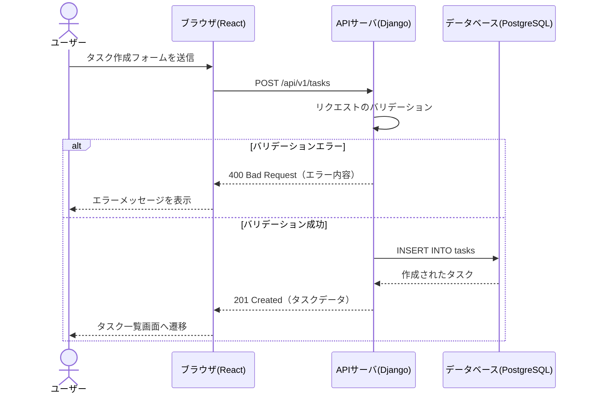
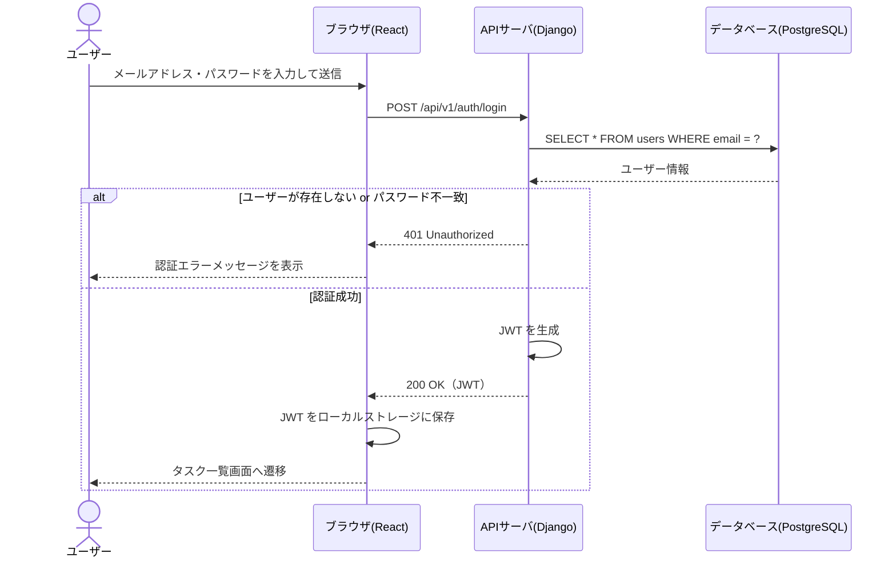
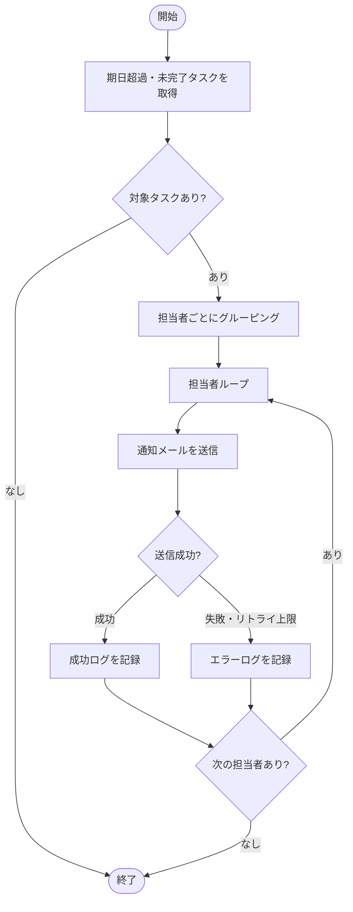
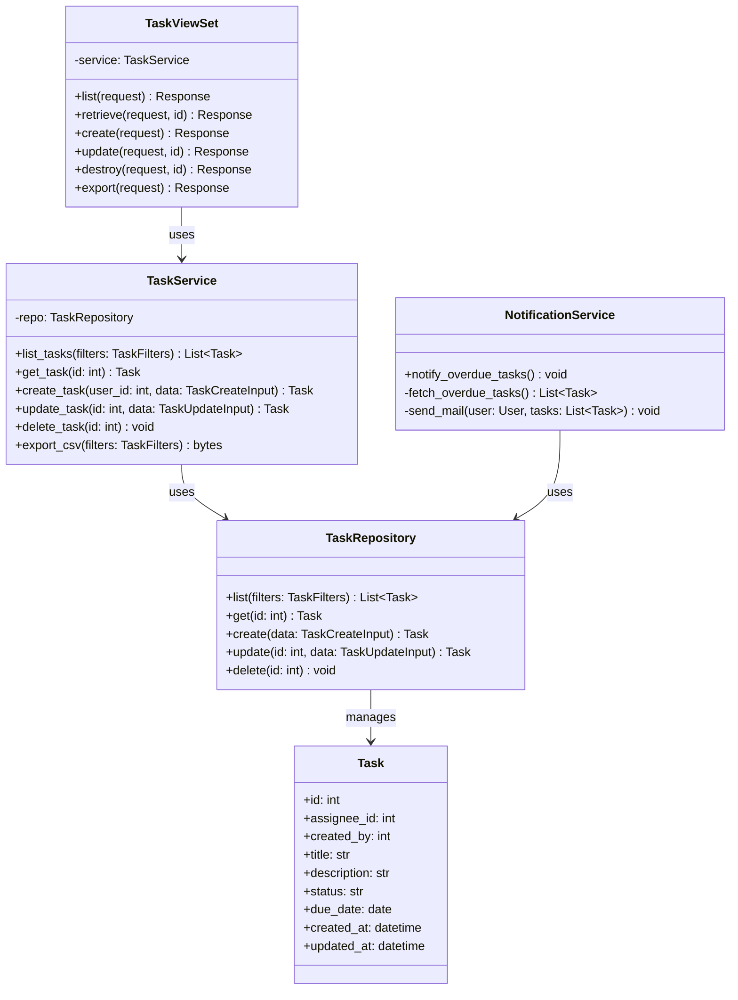

# 詳細設計書テンプレート

## 1. 処理シーケンス

### 1-1. 処理フロー図

機能の特性に応じてシーケンス図・アクティビティ図を使い分ける。兼用・組み合わせも可。[mermaid で表現しきれない場合は draw.io 等で作成する。]

- **シーケンス図**: API呼び出し・DB操作など、複数オブジェクト間の通信が中心の機能に使う
- **アクティビティ図**: 条件分岐・ループが多いバッチ処理や複雑な業務フローに使う

#### [機能名] — 例: タスク作成



#### [機能名] — 例: ログイン



### 1-2. アクティビティ図

制御フロー（分岐・繰り返し処理）を示す。[mermaid で表現しきれない場合は draw.io 等で作成する。]

#### [処理名] — 例: 期日超過通知バッチ



---

## 2. クラス設計

### 2-1. クラス図

[mermaid で表現しきれない場合は draw.io 等で作成する。]



### 2-2. クラス一覧

| クラス名 | パッケージ | 責務 | 主な依存クラス |
| --- | --- | --- | --- |
| TaskViewSet | tasks/views.py | HTTPリクエストの受付・レスポンス返却 | TaskService |
| TaskService | tasks/services.py | タスクに関するビジネスロジック | TaskRepository |
| TaskRepository | tasks/repositories.py | タスクの DB 操作を抽象化 | Task（Djangoモデル） |
| Task | tasks/models.py | tasks テーブルの ORM モデル | — |
| NotificationService | notifications/services.py | 期日超過通知メールの送信 | TaskRepository |
| AuthViewSet | auth/views.py | ログイン・ログアウト処理 | Django認証機能 |

---

## 3. 実装方針

命名規則・インデント・フォーマットは lint / フォーマッタ（PEP8 / ESLint / Prettier 等）に委ねる。ここではツールで強制できない判断基準を定義する。

### 3-1. プロジェクト構成

```
project-root/
├── backend/
│   ├── config/          # Django 設定・URL ルーティング
│   ├── tasks/           # タスク機能（models / views / services / repositories）
│   ├── auth/            # 認証機能
│   ├── notifications/   # 通知機能
│   └── common/          # 共通ユーティリティ・基底クラス
└── frontend/
    ├── src/
    │   ├── components/  # 再利用可能な UI コンポーネント
    │   ├── pages/       # ページ単位のコンポーネント
    │   ├── hooks/       # カスタムフック
    │   ├── api/         # API クライアント
    │   └── utils/       # 共通ユーティリティ
    └── public/
```

**レイヤー分割の方針**

- `views.py`（ViewSet）: HTTPリクエストの受付・レスポンス返却のみ。ビジネスロジックは書かない
- `services.py`: ビジネスロジックを担う。DBアクセスは直接行わず Repository を通す
- `repositories.py`: DB操作を抽象化する。ORM の呼び出しはここに集約する

### 3-2. エラー処理・ログ出力

**エラー処理方針**

| エラー種別 | HTTPステータス | 対応方針 |
| --- | --- | --- |
| バリデーションエラー | 400 | エラー内容をレスポンスに含めてクライアントに返す |
| 認証エラー | 401 | エラーメッセージのみ返す（詳細は返さない） |
| 権限エラー | 403 | エラーメッセージのみ返す |
| リソース未存在 | 404 | エラーメッセージを返す |
| サーバー内部エラー | 500 | エラーログを出力し、詳細をクライアントに返さない |

**リクエストトレーシング**

リクエスト受信時に UUID v4 のリクエストIDを採番し、そのリクエストで出力するすべてのログに付与する。レスポンスヘッダ（`X-Request-ID`）にも含め、クライアントからの問い合わせ時に追跡できるようにする。

```
# ログ出力例
{"timestamp": "2026-05-06T09:00:00Z", "level": "INFO", "request_id": "550e8400-e29b-41d4-a716-446655440000", "message": "タスク作成成功", "task_id": 42}
```

**ログレベル定義**

| レベル | 意味 | 対応方針 | 出力例 |
| --- | --- | --- | --- |
| DEBUG | 開発・調査時の詳細情報。本番では原則出力しない | 対応不要 | クエリパラメータ、処理の中間状態 |
| INFO | 正常系の重要イベントの記録 | 対応不要（定期的な傾向確認は推奨） | ログイン成功、タスク作成完了 |
| WARN | 今すぐ致命的ではないが、放置・頻発するとシステムに影響が出る事象 | 翌営業日までに原因を確認 | リトライ発生、外部API遅延、非推奨APIの呼び出し |
| ERROR | 即時対応が必要な障害。アラート通知と連動させる | 発生から30分以内に担当者が確認 | DB接続失敗、予期しない例外、データ不整合 |
| CRITICAL | システム全体が停止・継続不能な致命的障害 | 即時エスカレーション | アプリ起動失敗、設定ファイル読み込み不能 |

**ログに含める項目**

| 項目 | 形式 | 必須 |
| --- | --- | --- |
| timestamp | ISO 8601（UTC） | ○ |
| level | DEBUG / INFO / WARN / ERROR / CRITICAL | ○ |
| request_id | UUID v4 | ○ |
| message | 自然言語による説明 | ○ |
| stack_trace | エラー発生時のみ | エラー時のみ |
| error_code | アプリ定義のエラーコード | エラー時のみ |

### 3-3. 禁止事項

- SQL のハードコーディング禁止（ORM を使用すること）
- パスワード・シークレットキーのソースコードへの直書き禁止（環境変数で管理）
- フロントエンドでのビジネスロジック実装禁止（API サーバに実装すること）
- `print()` によるデバッグ出力禁止（ロガーを使用すること）

---

## 4. ストレージ物理設計

基本設計のスキーマ定義（`docs/specs/basic-design.md`）を実装レベルに具体化する。

### 4-1. インデックス設計

| テーブル名 | インデックス名 | 対象カラム | 種別 | 目的 |
| --- | --- | --- | --- | --- |
| tasks | idx_tasks_assignee_id | assignee_id | 通常 | 担当者によるタスク絞り込み |
| tasks | idx_tasks_status | status | 通常 | ステータスによる絞り込み |
| tasks | idx_tasks_due_date | due_date | 通常 | 期日超過タスク検索（バッチ処理） |
| users | idx_users_email | email | UNIQUE | ログイン時のメールアドレス検索 |

### 4-2. 制約・デフォルト値の詳細

#### tasks テーブル

| カラム名 | 追加制約 | デフォルト値 | 備考 |
| --- | --- | --- | --- |
| status | CHECK (status IN ('todo', 'in_progress', 'done')) | 'todo' | 3値のみ許容 |
| created_at | — | NOW() | INSERT 時に自動設定 |
| updated_at | — | NOW() | UPDATE 時にトリガーで自動更新 |

---

## 5. 各種一覧

### 5-1. パラメータ一覧（環境変数）

| パラメータ名 | 説明 | デフォルト値 | 必須 |
| --- | --- | --- | --- |
| DATABASE_URL | PostgreSQL 接続 URL | — | ○ |
| SECRET_KEY | Django シークレットキー | — | ○ |
| JWT_EXPIRY_HOURS | JWT の有効期限（時間） | 24 | — |
| SMTP_HOST | メール送信サーバのホスト | — | ○ |
| SMTP_PORT | メール送信サーバのポート | 587 | — |
| MAX_RETRY_COUNT | メール送信リトライ上限回数 | 3 | — |

### 5-2. コード一覧

#### タスクステータス（tasks.status）

| コード値 | 表示名 | 説明 |
| --- | --- | --- |
| todo | 未着手 | 作成直後の初期ステータス |
| in_progress | 進行中 | 着手済みのタスク |
| done | 完了 | 完了したタスク |

### 5-3. メッセージ一覧

| メッセージID | 種別 | 表示内容 | 表示タイミング |
| --- | --- | --- | --- |
| MSG-001 | エラー | メールアドレスまたはパスワードが正しくありません | ログイン失敗時 |
| MSG-002 | エラー | タイトルは必須です | タスク保存時のバリデーションエラー |
| MSG-003 | エラー | タイトルは200文字以内で入力してください | タスク保存時のバリデーションエラー |
| MSG-004 | 確認 | タスクを削除しますか？この操作は取り消せません | タスク削除ボタン押下時 |
| MSG-005 | 成功 | タスクを作成しました | タスク作成完了時 |
| MSG-006 | 成功 | タスクを更新しました | タスク更新完了時 |
| MSG-007 | 成功 | タスクを削除しました | タスク削除完了時 |

---

## 6. 外部インターフェース設計

外部システムとの連携がない場合はこのセクションを削除する。

### 6-1. [外部システム名] — 例: メール送信（SMTP）

**接続先・操作方法**

| 項目 | 内容 |
| --- | --- |
| 接続先 | SMTP_HOST 環境変数で指定（例: smtp.example.com） |
| ポート | 587（STARTTLS） |
| 操作方法 | Python `smtplib` / Django `send_mail()` を使用 |

**プロトコル・データ形式**

| 項目 | 内容 |
| --- | --- |
| プロトコル | SMTP（STARTTLS） |
| 文字コード | UTF-8 |
| 本文形式 | テキスト / HTML |

**認証・セキュリティ**

| 項目 | 内容 |
| --- | --- |
| 認証方式 | SMTP AUTH（ユーザー名・パスワード） |
| 認証情報の管理 | 環境変数（`SMTP_USER`, `SMTP_PASSWORD`）で管理 |
| 通信の暗号化 | STARTTLS |

**エラー・例外処理**

| エラー種別 | 対応方針 |
| --- | --- |
| 接続タイムアウト | 最大3回リトライ（1秒間隔）。上限超過でエラーログを出力しスキップ |
| 認証失敗 | リトライなしでエラーログを出力しバッチ全体を中断 |
| 送信失敗（受信者拒否） | エラーログを出力し、次の受信者の送信を継続 |
